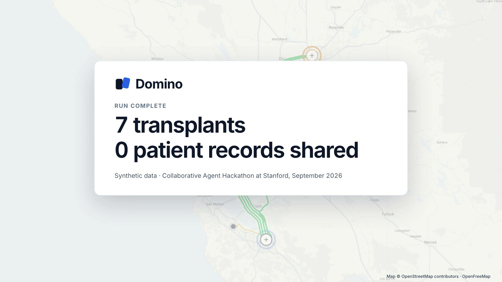

# Domino — launch video

[](brag.mp4)

**[▶ Watch brag.mp4](brag.mp4)** · 24 seconds · 1080p · narrated

Domino lets hospitals find kidney-swap matches across hospitals without any patient file leaving its hospital. Each hospital runs its own agent on its own machine and answers a coordinator in categories only; code does the matching. Built at the Collaborative Agent Hackathon at Stanford, September 2026. Source: [akshat0714/domino](https://github.com/akshat0714/domino).

**All data is synthetic.** The hospitals, patients and donors in the video are fictional.

## What is real in the video

- The map is a capture of the app's own map page; routes are drawn on the app's cached road geometry.
- Byte counts, the `LAN` badge and the audit line come from the public event log of a real three-hospital LAN run on 2026-09-29.
- The chain and the final count come from the project's verified run of show (`docs/SPEC.md` in the main repo).
- The coordinator's lines ("They asked for one. The network found three.", "No consensus. Planning again without the held pair.", "One stranger starts a chain of 5.") are the app's own.

## Files

| Path | What |
| --- | --- |
| `brag.mp4` | The video (poster baked as frame 0) |
| `brag.jpg` | Poster frame |
| `share-copy.txt` | Caption for posting |
| `brag-plan.md` | Storyboard, narration script, audio plan |
| `composition-brief.md` | Hand-off brief for the composition |
| `composition/` | [Hyperframes](https://hyperframes.heygen.com) project that renders the video |

## Re-render

```bash
cd composition
# put the music bed at assets/music/happy-beats-business-moves-vol-12-by-ende-dot-app.mp3 (see Credits)
npx hyperframes check
npx hyperframes render --quality high --output ../brag.mp4
```

Needs Node 22+ and FFmpeg. The composition uses local assets only: the map image, the road data, the four narration clips, the sound effects and GSAP.

## Credits

- Map data © [OpenStreetMap](https://www.openstreetmap.org/copyright) contributors; tiles and style by [OpenFreeMap](https://openfreemap.org); routing by OSRM.
- Music: "Happy Beats / Business Moves vol. 12" by [ende.app](https://ende.app/en) (not included in this repository).
- Sound effects: [Kenney](https://kenney.nl), CC0.
- Narration: [Kokoro-82M](https://github.com/hexgrad/kokoro) voice `af_heart`, generated locally through Hyperframes.
- Animation runtime: [GSAP](https://gsap.com).
